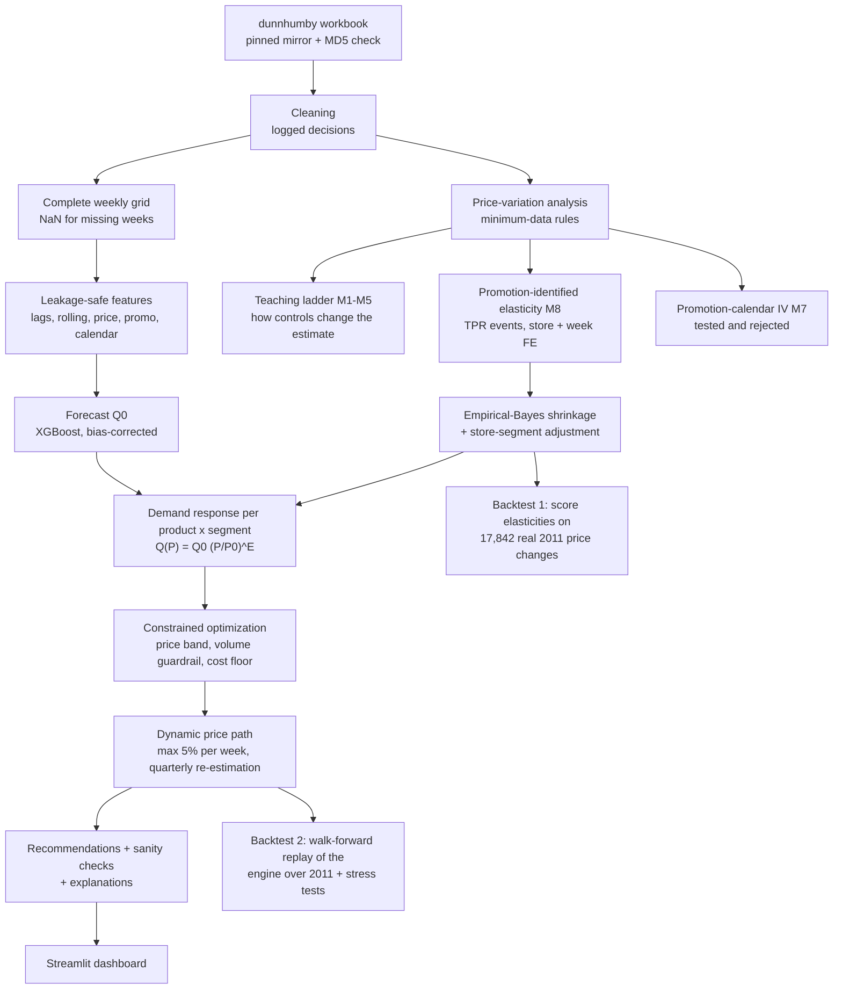

# Dynamic Pricing Engine for Retail Demand Optimization

A pricing decision system built on real grocery scanner data (dunnhumby *Breakfast at the Frat*):

**Demand forecasting → Promotion-identified price elasticity → Constrained optimization → Dynamic weekly price paths → Historical backtesting**

| Component | What it does |
|---|---|
| Demand forecasting | XGBoost + LightGBM with lag and rolling features, walk-forward CV, beats a seasonal-naive baseline by 51% (WMAPE) |
| Price elasticity | Product-level log-log elasticities, identified from **temporary-price-reduction events** to address confounding, with empirical-Bayes shrinkage and store-segment adjustments |
| Optimization | SciPy bounded optimization of (assumed-cost) profit per product × store segment, under price-band, volume and cost constraints |
| Dynamic engine | Elasticities re-estimated quarterly, targets recomputed weekly, prices moved toward target at ≤ 5% per week |
| Backtesting | (1) 2009-10 elasticities scored against **17,842 real 2011 price changes**; (2) walk-forward replay of the engine over 2011 |

> Every number in this README is produced by `python run_pipeline.py` and can be traced to a file in `reports/results/`.
> Profit figures use an **ASSUMED** 30% gross margin; the dataset contains no cost data.
> Simulated gains are **model-based estimates, not observed outcomes**.

---

## Problem
Given historical demand, prices, promotions and seasonality, **what regular price should a retailer charge for each product next week,
within realistic business constraints, and why?**

## Business motivation
Regular-price decisions move margin more than almost any other lever, but they are usually set by rules of thumb ("+5%", "match
competitor"). A data-driven price needs three things that a forecasting model alone does not provide:

1. **how much will sell at today's price** (forecast),
2. **how that changes if the price changes** (elasticity, a *causal-flavoured* question),
3. **which price is best under constraints** (optimization).

## Prediction vs causal inference vs optimization
This distinction is the backbone of the project.

| | Question | Tool here | What can go wrong |
|---|---|---|---|
| **Prediction** | "How many units will sell next week, *given the plans we already have*?" | XGBoost / LightGBM | Leakage, overfitting; but correlation is enough |
| **Causal inference** | "How many units *would* sell *if we changed* the price?" | Log-log regression identified from promotion events, with fixed effects | Confounding, reverse causality, selection; correlation is **not** enough |
| **Optimization** | "Which price maximises the objective, subject to constraints?" | SciPy bounded scalar optimizer | Garbage in, garbage out: it trusts the causal estimate completely |

A model can forecast brilliantly and still give a wrong answer to the *what-if* question. XGBoost's own price response is monotone for
only 43% of products (notebook 04).

## Dataset
**dunnhumby "Breakfast at the Frat"**: 156 weeks (2009-01-14 → 2012-01-04), 77 stores, 55 products in 4 categories (pretzels, cold
cereal, frozen pizza, mouthwash). Weekly store × product units, **actual shelf price, regular (base) price**, feature-ad, display and
temporary-price-reduction flags. Selected over 7 alternatives (Dominick's, Complete Journey, M5, Favorita, Rossmann, Walmart, UCI Online Retail);
see [`dataset_selection.md`](dataset_selection.md). Acquisition and checksum: [`data/README.md`](data/README.md).

## Architecture



## Methodology

### Data pipeline (`src/preprocessing.py`, notebook 01)
Only **24 of 524,950 rows** were removed (5 voided rows with zero units, 19 with no recoverable price). Everything else is repaired or flagged,
and every step is logged in `reports/results/cleaning_log.csv`. Notable findings:
* `SPEND = PRICE × UNITS` holds exactly, so `PRICE` is the realised average price.
* Two stores are listed twice in the store lookup. A naive join would have **duplicated 13,693 transactions**.
* 4,937 rows had shelf price > base price. The base price was raised to the shelf price and the rows flagged.
* 1,734 extreme-unit rows are **flagged, not deleted** (often real promotion spikes); elasticity is re-estimated without them as a robustness check (correlation 0.964).
* **Stockout problem:** weeks without sales have no row, so zero demand, stockout and not-ranged are indistinguishable. Missing weeks are kept as
  NaN (never 0), 8.7% of the calendar grid.

### Demand forecasting (`src/forecasting.py`, notebook 02)
* One-week-ahead units per store × product, 43 features. Demand history is strictly lagged. **Target-week price and promotion are
  inputs**, because they are planned in advance; this is what makes "what-if price" scenarios possible.
* **Validation:** 2011 is a fully untouched test year. Model selection uses 4 expanding walk-forward folds inside 2009-2010, split on weeks.
  No random K-fold (it would put the same week in train and validation, and the rolling features overlap the targets).
* Target `log1p(units)`. Its retransformation bias (−5.5%) is corrected with a factor estimated on the last training fold.

### Price elasticity (`src/elasticity.py`, notebook 03)
Log-log model `log Q = β log P + controls`; β = elasticity.
* **Teaching ladder (M1-M5):** naive → + feature/display → + store FE & seasonality → + store & week FE → regular vs temporary price.
  It shows how much the naive estimate is contaminated by confounding.
* **Decision model (M8), identified from promotion events:** the sample keeps only weeks with no promotion or a **pure temporary price
  reduction (TPR) without feature ad or display**, so the price cut is not bundled with advertising. Store FE remove permanent store differences;
  **week FE remove the chain's promotion timing** and every chain-wide shock. The elasticity is therefore identified by stores running *different*
  temporary discounts in the same week. Last week's discount controls for pantry loading. SEs are clustered by store.
* **Promotion-calendar IV (M7), tested and rejected:** promotions are set centrally (≈74% of discount variance is chain-wide), so a store's
  price was instrumented with the same product's discount in other stores that week. The instrument is strong (median first-stage F ≈ 1,900)
  but invalid: its estimates reproduce the naive OLS, because the chain schedules promotions into demand peaks. It also fails out of sample.
* **Product-level for every product:** empirical-Bayes (DerSimonian-Laird) shrinkage pulls each noisy product estimate toward its category
  mean in proportion to its standard error. Every product keeps its own estimate; none is replaced by a category average.
* **Store segments:** M8 with segment interactions (value / mainstream / upscale), deviations shrunk toward 0 within category.

### Optimization and the dynamic engine (`src/optimization.py`, notebook 04)
For each product × store segment: `Q(P) = Q0·(P/P0)^E`, where `Q0` is the XGBoost forecast at the current regular price `P0` with promotions off.
Maximise profit `(P − C)·Q(P)` with **ASSUMED** `C = 0.7 × chain price`, subject to: price within ±20% of current, **expected units may fall at most
10%**, and `P > C`. Solved with `scipy.optimize.minimize_scalar(method="bounded")` and cross-checked against a grid and the closed-form optimum.

**Dynamic behaviour:** the target is recomputed every week from the latest forecast, elasticities are re-estimated every quarter on all data available so far,
and the shelf price moves toward the target by at most 5% per week. Prices therefore differ by store type and evolve over time.

### Historical backtesting (`src/backtesting.py`, notebook 04)
Everything is estimated on **2009-2010 only** and evaluated on **2011**.
1. **Price-response validation:** each elasticity model predicts the sales lift of **17,842 real 2011 store-weeks** where a store cut its price
   without ad or display. Predictions are compared with what actually happened (MAE skill vs "no price effect", calibration slope),
   with chain-wide weekly shocks removed by comparing against non-promoting stores the same week.
2. **Walk-forward replay of the dynamic engine:** quarterly re-estimation, weekly price paths, 2011 replayed with the actual promotion calendar.
   This part is a counterfactual simulation (units adjusted by `m^E`) and is stress-tested with alternative elasticities.

## Results

### Forecasting: 2011 test year (`reports/results/model_comparison_test.csv`)
| Model | MAE | RMSE | WMAPE | Bias |
|---|---|---|---|---|
| Seasonal naive (lag 52) | 11.07 | 26.48 | 0.587 | +3.1% |
| Moving average (4 weeks) | 8.54 | 20.73 | 0.453 | +0.6% |
| Naive (last week) | 8.16 | 20.22 | 0.433 | +0.1% |
| **XGBoost** (bias-corrected) | **5.42** | **11.29** | **0.288** | −1.0% |
| LightGBM (bias-corrected) | 5.41 | 11.30 | 0.287 | −1.0% |
| XGBoost, no bias correction | 5.41 | 11.38 | 0.287 | −5.5% |

XGBoost cuts WMAPE by **34% vs the naive forecast** and **51% vs seasonal naive**. Seasonal naive is the *worst* baseline: demand is driven by a
promotion calendar that changes each year. Walk-forward CV (mean WMAPE: XGBoost 0.298, LightGBM 0.296, naive 0.471) agrees with the test.
Top SHAP drivers: long-run level (expanding mean), last week's units, product identity, feature ad, price relative to the recent regular price.

### Elasticity (`reports/results/`)
| Specification | Median elasticity across products |
|---|---|
| M1 naive OLS | −2.07 |
| M2 + promo controls | −1.51 |
| M4 + store FE + week FE | −0.94 |
| M6 TPR-only sample | −0.87 |
| M7 promotion-calendar IV (rejected) | −2.05 |
| **M8 promotion-identified (decision model, raw)** | **−0.84** |
| M8 after shrinkage | −0.81 |

* Naive regressions overstate price sensitivity: controlling for confounders roughly halves the typical estimate. For **4 products the naive
  elasticity is positive** (e.g. private-label pretzels +1.8), which reverses once store effects are removed.
* The IV reproduces the naive estimate, a sign that the promotion calendar is itself correlated with demand.
* Shrinkage turns implausible noisy estimates into usable ones (Mike-sell's Pretzel Sticks +1.55 ± 0.77 → −0.13). 51 of 55 products have a usable
  (clearly negative) product-level elasticity; 4 do not and are not priced.
* Store-segment differences exist (18 of 93 estimated deviations are significant; upscale stores tend to be less price-sensitive) but are small after shrinkage.

### Backtest 1: price-response validation on real 2011 outcomes (`price_response_validation.csv`)
| Model (estimated on 2009-10) | MAE skill vs "no price effect" | Calibration slope (1 = right magnitude) |
|---|---|---|
| M1 naive OLS | 1.7% | 0.39 |
| M4 controlled OLS | 7.8% | 0.85 |
| M7 promotion-calendar IV | −21.8% | 0.08 |
| M8 promotion-identified, raw | 5.7% | 0.65 |
| **M8 + shrinkage + store segment (engine)** | **6.0%** | **1.03** |

The engine's elasticities predict real held-out price responses with the **right magnitude** (calibration ≈ 1.0), while the naive OLS overstates
them about 2.5×. Controlled OLS has slightly better MAE skill but under-states magnitudes. Absolute skill is modest because single store-weeks are noisy.
The validation covers price *cuts*, the variation that exists; price increases are an extrapolation.

### Next-week recommendations (week ending 2012-01-11) (`business_recommendations*.csv`)
47 products × 3 store segments = 141 price recommendations; all pass every sanity check. 8 products are not priced (Colgate Wisp discontinued,
three Quaker cereals being phased out, four with no usable price response).

| Product | Current | Target | Change | Elasticity (by segment) | Units/wk now → at target |
|---|---|---|---|---|---|
| GM Honey Nut Cheerios 12.25 oz | $2.89 | $3.47 | +20.0% | −0.14 to −0.05 | 4,481 → 4,391 |
| PL Mini Twist Pretzels 15 oz | $1.54 | $1.74 | +13.3% | −0.89 to −0.79 | 4,115 → 3,703 |
| DiGiorno Pepperoni 28.3 oz | $5.67 | $6.05 | +6.8% | −1.66 to −1.49 | 1,502 → 1,352 |
| Frescetta Pepperoni 27.35 oz | $7.03 | $8.43 | +20.0% | −0.41 to −0.37 | 232 → 215 |

Median target change +14.1%; 94 recommendations are limited by the volume guardrail and 47 by the price band. With the 5%/week rule each target is
reached in 2-4 weeks. At target, expected weekly revenue changes $145.6k → $150.2k and assumed-cost profit $43.7k → $57.0k.

**Why prices go up (the most important caveat).** For a profit-maximiser the optimal margin is −1/E (Lerner condition). 32 of the 51 usable products have
|E| ≤ 1, for which profit keeps rising with price; without the guardrail **every** product would hit +20%. A single-product model omits store traffic,
basket effects, competitor matching and long-run customer loss, and the volume guardrail stands in for them. Read the output as *"which products have
room to test a price increase, and roughly how much"*.

### Backtest 2: walk-forward replay of the dynamic engine, 2011 (`backtest_summary.csv`)
| Scenario (2011, policy estimated only on data available at each quarter) | Revenue | Assumed-cost profit | Units |
|---|---|---|---|
| **Dynamic engine, judged by its own elasticities** | +1.8% | **+34.3%** | −8.3% |
| same schedule, elasticities re-estimated on 2011 | +1.6% | +34.4% | −7.2% |
| same schedule, less-elastic CI bound | +6.0% | +39.6% | −5.2% |
| same schedule, more-elastic CI bound | −2.8% | +27.9% | −12.3% |
| same schedule, judged by controlled OLS (M4) | −2.0% | +29.5% | −11.3% |
| Static policy (one immediate change, no segments) | +1.8% | +35.0% | −8.5% |
| Rule of thumb +5% on everything | +0.1% | +15.4% | −4.7% |
| Naive-OLS policy | +1.5% | +7.6% | −0.9% |
| Dynamic engine, assumed margin 20% / 40% | +1.8% / +1.8% | +70.2% / +20.8% | −8.3% / −8.2% |

* The simulated gain stays clearly positive under every alternative elasticity, including a different model (M4).
* **Dynamic vs static:** the dynamic engine does *not* add simulated profit here (+34.3% vs +35.0%). Phasing prices in at 5%/week gives up a little
  early profit, and the store-segment differences are small. Its value is **control and adaptivity** (smaller weekly jumps, quarterly re-estimation,
  store-type pricing), not extra profit in this data.
* The % gain depends heavily on the **unobserved margin** (+21% to +70%). These are model-based estimates, not observed outcomes.

## Limitations
* **Observational elasticities.** Promotion-based identification with store and week fixed effects removes the ad/display confound, store
  differences and chain-wide timing, but not *local* store-week confounding (a store discounting in response to local demand).
* **Price cuts vs increases.** The elasticity is identified and validated on temporary price *cuts*; the engine also uses it for increases (assumed symmetric).
* **No cost data.** Every profit number rests on the ASSUMED 30% margin.
* **Stockouts / selection.** Zero-sales weeks are unobserved, so elasticities exclude weeks where demand hit zero.
* **Constant elasticity** is a local approximation (reasonable within ±20%).
* **No cross-price effects.** Cannibalisation and category switching are ignored; each product is optimised alone.
* **Counterfactual ≠ causal.** Competitors, promotions and customer habits would react to new prices; the simulation holds them fixed.
* **Old data** (2009-2011) from one retailer and 4 categories.

**How to validate for real:** a randomised store-level price test (matched test/control stores, 8-12 weeks, difference-in-differences on
units, margin and basket metrics), within legal and fairness constraints.

## How to run
```bash
python -m venv .venv && source .venv/bin/activate      # Python 3.12
pip install -r requirements.txt
python run_pipeline.py --download        # downloads + verifies data, then runs every stage (~10 min on 1 CPU)
# or stage by stage:
python run_pipeline.py --stage data      # clean + EDA figures
python run_pipeline.py --stage features
python run_pipeline.py --stage cv        # walk-forward CV (or --stage cv --fold 2)
python run_pipeline.py --stage forecast  # final models + 2011 test
python run_pipeline.py --stage shap
python run_pipeline.py --stage elasticity
python run_pipeline.py --stage optimize  # next-week recommendations (product x store segment)
python run_pipeline.py --stage backtest  # price-response validation + walk-forward dynamic replay
jupyter lab notebooks/                   # read in order 01 -> 04 (run the pipeline first)
streamlit run app/streamlit_app.py
```

## Project structure
```
retail-price-optimization/
├── README.md, dataset_selection.md, PROJECT_DECISIONS.md, INTERVIEW_PREPARATION.md, GLOSSARY.md
├── requirements.txt, .gitignore, run_pipeline.py
├── data/            README.md (acquisition), raw/ (not committed), processed/
├── notebooks/       01_eda · 02_demand_forecasting · 03_price_elasticity · 04_price_optimization_backtesting (executed)
├── src/             config · data_loader · preprocessing · feature_engineering · forecasting · evaluation
│                    elasticity · optimization · backtesting · visualization
├── models/          xgb_train_only.json, lgb_train_only.txt, xgb_production.json, category_levels.json
├── reports/         figures/ (14 PNGs), results/ (all tables + metrics.json)
└── app/             streamlit_app.py
```
`src/config.py` holds every assumption and threshold in one place.

## Future improvements
* **Cross-price elasticities** within a category and a joint (multi-product) optimisation to capture cannibalisation.
* **Full hierarchical Bayesian model** (product, segment and store levels jointly) instead of two-step empirical-Bayes shrinkage.
* **Demand-model-consistent optimisation:** a monotone-constrained gradient-boosting model (monotone in price) or a structural demand model.
* **Promotion optimisation** (depth, frequency, feature/display), and demand-state-dependent elasticities so weekly prices react to forecasted demand peaks.
* **Real cost data**, inventory constraints and price-ending rules ($x.99).
* **Designed experiments** to obtain causal elasticities, and an online learning loop that updates them.
